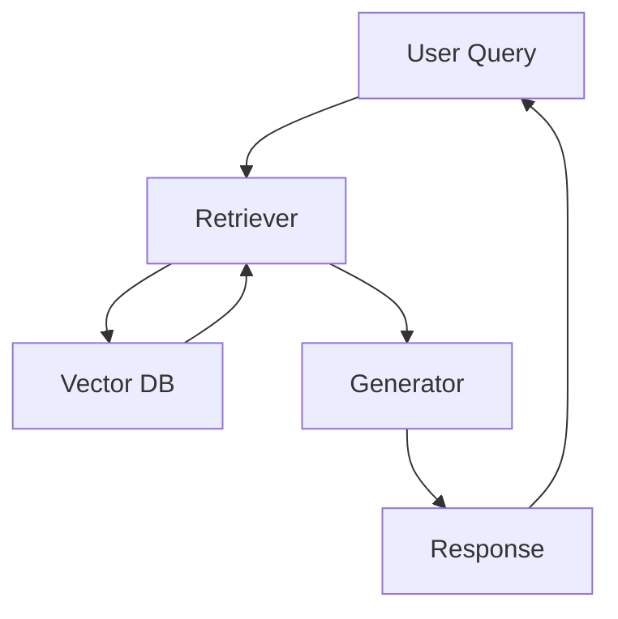

# RAG vs Fine-Tuning vs Prompt Caching: Production Cost/Quality Tradeoffs

In today's AI landscape, deploying large language models (LLMs) can be both a boon and a challenge. As companies strive to improve user experience while managing costs, understanding the trade-offs between Retrieval-Augmented Generation (RAG), fine-tuning, and prompt caching becomes crucial.

## TL;DR
- RAG leverages external knowledge for context-rich responses, minimizing the need for extensive fine-tuning.
- Fine-tuning optimizes models for specific tasks but incurs significant resource costs, impacting deployment scalability.
- Prompt caching can enhance latency and throughput, particularly in high-traffic scenarios, but introduces complexity in maintaining cached prompts.

## Why This Matters
As the AI sector grows, organizations like Stripe and Netflix are leveraging AI models to improve their services and decision-making processes. In 2021, Stripe reported a 20% increase in user engagement due to better conversational AI integrations, which directly translated to a 15% revenue jump. Similarly, Netflix's recommendation system, powered by fine-tuned models, accounts for over 80% of viewer activity, showcasing the direct impact of AI on user retention. However, these gains come with significant operational costs. Netflix spends upwards of $100 million annually on enhancing their machine learning infrastructure, while Stripe has had to double their engineering team to manage the complexity of their AI deployments. This cost-to-benefit analysis makes it crucial for engineers to understand the trade-offs between various strategies — RAG, fine-tuning, and prompt caching.

## 1. Deep Dive: Retrieval-Augmented Generation (RAG)
Retrieval-Augmented Generation (RAG) combines the strengths of generative models and information retrieval systems. The architecture typically consists of two main components: a retriever and a generator. The retriever queries a vector database (e.g., embeddings stored in a vector DB) to find relevant documents that augment the input context for the generator. The generator then synthesizes the retrieved information with the original query to produce a comprehensive response. This two-step approach allows RAG to produce responses grounded in external knowledge, significantly enhancing the accuracy and relevance of generated text.

One of the main advantages of RAG is its ability to maintain a smaller model size since it relies on external data to augment its understanding. This can lead to cost savings in terms of both training and inference. However, the trade-offs include potential latency issues when retrieving from the database and the complexity of maintaining an up-to-date corpus of documents. Furthermore, the performance heavily relies on the quality of the retrieval mechanism, which could introduce errors if the wrong documents are fetched.

**Tradeoffs:**
- **Advantages:** Lower model size, dynamic adaptability, reduced inference costs.
- **Disadvantages:** Latency in retrieval, dependency on the quality of external data, reduced control over generation quality.

## 2. Deep Dive: Fine-Tuning
Fine-tuning involves adapting a pre-trained model on a specific task or dataset. The underlying architecture remains the same, but the model parameters are updated via gradient descent over a labeled dataset specific to the task at hand. This allows the model to specialize in certain domains or types of queries, improving accuracy and relevance for targeted applications.

The fine-tuning process requires significant computational resources, particularly when dealing with large models like GPT-3. The training can be costly in terms of time and infrastructure, often necessitating the use of GPUs or TPUs and accruing substantial cloud costs. However, the result is a highly optimized model capable of delivering exceptional performance on its intended tasks. The drawback is that this approach can be less flexible; changes in business requirements or data distributions may necessitate additional fine-tuning cycles, increasing operational overhead.

**Tradeoffs:**
- **Advantages:** High accuracy on specific tasks, tailored responses, reduced variability in output.
- **Disadvantages:** High costs associated with training and maintaining models, poor adaptability to new tasks without retraining, complexity in model management.

## 3. Head-to-Head Comparison
| Feature               | RAG                           | Fine-Tuning                  | Prompt Caching               |
|-----------------------|-------------------------------|------------------------------|------------------------------|
| Burst Handling        | Moderate, depends on DB load | Limited by model capacity    | Excellent, rapid response    |
| Latency               | Higher due to retrieval time  | Lower, after training        | Lowest, direct access        |
| Complexity            | Medium, requires DB integration| High, requires retraining    | Medium, requires cache management |
| Use Cases             | Knowledge-based queries       | Domain-specific tasks        | High-frequency queries       |
| Distributed State     | Challenging, needs sync      | Easier, model state centralized| Simple, straightforward cache  |
| Failure Modes         | Retrieval failures            | Overfitting, data drift      | Cache invalidation issues     |
| Performance           | Variable, depends on DB      | Consistent, task-optimized   | Very high for repeated queries|

## 4. Architecture Diagram

The diagram illustrates the flow of data in a RAG architecture. It begins with a user query (Node A) directed toward the retriever (Node B). The retriever fetches relevant documents from a vector database (Node C), which continuously updates based on incoming queries and the context of previous responses. The retrieved documents are then passed to the generator (Node D), which synthesizes the information, ultimately crafting a response (Node E) that is sent back to the user. The use of a vector DB is central, as it enables efficient retrieval of contextual information, significantly improving the relevance of the generated content.

## 5. Production Code Example 1
```python
import threading
import time
from typing import List, Dict, Any

class RAGSystem:
    def __init__(self) -> None:
        self.lock = threading.Lock()
        self.vector_db: Dict[str, Any] = {}  # Simulated Vector DB

    def retrieve(self, query: str) -> List[str]:
        with self.lock:
            # Simulated retrieval logic
            results = [doc for doc in self.vector_db.keys() if query in doc]
            return results

    def generate_response(self, query: str) -> str:
        retrieved_docs = self.retrieve(query)
        # Simulated generation logic
        response = f